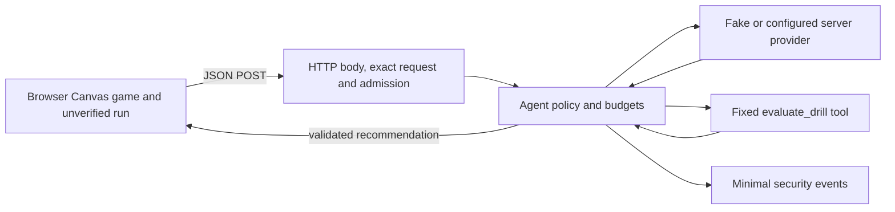

# W08 Secure the Arcade — evidence

**State (2026-10-28):** The HTTP/browser and agent/tool/provider controls, including HTTP error-body cleanup, are implemented and verified with Codex assistance at code checkpoint `ad2e83b`; the initial W08 baseline is `fe4029c`. Current local results are **53/53 W08 tests and 214/214 full regression tests**, production browser checks, a controlled build-secret proof with source maps, and three measured synthetic traces. Both members' document approvals and specific contributions through direction/review of AI-assisted changes are recorded below. T001, T030 and T032 are complete: the pair's reported eight-minute demo, role swap, three outcomes and individual cross-explanations were confirmed on 2026-10-28 and are recorded below. `NOT RUN` means no result has been observed; `TBD` means a person's action is not known. All adversarial tests use synthetic data and fake/stubbed providers. See [the pair split](../specs/005-secure-the-arcade/handoff-milica-nemanja.md) and [demo guide](../specs/005-secure-the-arcade/demo-guide.md).

## Follow-up after the grading review — 2026-10-28

Milica requested all five review findings be addressed. The response-body protection, full CI integration and document-status mismatch are fixed. Contributions are now tied to actual requests and previously recorded reviews. The technical material for the demo is executable; an automated run cannot establish the members' own explanations or role rotation.

| Change | Measured evidence and boundary |
|---|---|
| Cancel unsuccessful provider responses before retry | The original two-run synthetic 503 probe made two attempts per run and created four response bodies, with **0 cancelled**. The same scenario after the fix created four bodies and **cancelled all 4**. Both runs still end safely as `provider_unavailable`. No live provider or network transport was used. |
| Preserve capacity during cleanup | New 429/503 tests assert that the next attempt waits for cancellation. A cancellation failure keeps the safe status classification and disables retry. A stalled cancellation reaches the attempt timeout, returns 504, retains the admission slot, rejects excess work with 429, then permits a 200 response after settlement. Seven added regressions are in `tests/server/w08-provider.test.ts` and `tests/server/w08-admission.test.ts`. |
| Exercise full integration in CI | `.github/workflows/ci.yml` now runs `npm run verify` in the first job: typechecks, all unit/HTTP tests, build, secret scan and the actual fake API → preview proxy → browser flow. The separate W08 job retains adversarial, CSP/XSS and artifact checks. Both jobs use Node 24 and Ubuntu 24.04 without a real provider key. |
| Make demo traces repeatable | `npm run evidence:w08` uses the real HTTP handler, agent and evaluator with injected fake providers. It asserts observed counters and unchanged inputs, then prints the three traces below. It is preparation evidence, not a record that the pair performed a demo. |
| Reconcile document status | The specification checklist now agrees with T001's recorded approvals. This document is the detailed source for current results and contribution facts; the guide and personal drafts link here. |

Commands run by **Codex** on 2026-10-28 against the code saved as `ad2e83b`:

| Command / check | Actual result |
|---|---|
| Focused provider/admission/reliability tests and typecheck | Exit 0, 4 files / 25 tests; the initial new 429/503 cancellation tests failed before the implementation because the cancel count was 0. |
| `npm.cmd run test:security:w08` | Exit 0, 9 files / **53 tests**, 17-module build, positive scanner control and 4 clean artifacts including one source map, Edge CSP/XSS checks and secret scan. |
| `npm.cmd run verify` with fake provider | Exit 0, 34 files / **214 tests**, typechecks, build, secret scan, actual API/proxy, Edge normal/failure/restart flows and no browser errors. |
| `npm.cmd run evidence:w08` | Exit 0, all three asserted traces below. The first sandbox attempt failed before script startup with `uv_os_get_passwd/ENOMEM`; the normal-process run passed. |
| Same-fixture 503 cleanup probe | Exit 0, two safe failures with attempts `[2,2]`, 4 response bodies created and 4 cancelled. |

| Trace / input | HTTP / public code | Provider calls | Tool executions | Internal result |
|---|---|---:|---:|---|
| Valid score-1 run, two late drops | 200 | 2 | 1 actual `evaluate_drill` | `goal_completed`, 2 model steps |
| Same run with `maxSteps: 99` | 400 / `INVALID_REQUEST` | 0 | 0 | Agent not started |
| Otherwise valid run; fake model proposes `constructor` | 503 / `AGENT_UNAVAILABLE` | 1 | 0 | `unknown_tool`, 1 model step |

All three synthetic inputs remained unchanged; the successful real evaluator also preserved its arguments/counts. HTTP callers receive the safe public error, while the script observes the internal stop reason through the existing usage callback. This script was added on 2026-10-28 and is independent of the pair's reported 2026-10-27 demo.

### Independent recheck after pulling `7055ff6`, 2026-10-28

The [GitHub Actions run for `7055ff6`](https://github.com/mileusnicmilica/skyline_stack/actions/runs/40662652343) completed with a failed full-verification job. The W08 admission test at `tests/server/w08-admission.test.ts:246` expected recovery HTTP 200 but received 504. Its shared artificial provider timeout was 15 ms: it correctly expired the intentionally stalled first request but also applied to the later normal two-decision recovery request on the busy Ubuntu runner. This was a test timing defect; the log does not show a new production failure. The test now allows 500 ms per attempt and 2,500 ms total while still holding the first error-body cancellation until timeout and checking that the admission lease remains occupied. The focused test passed locally, 1 selected test / 6 skipped.

Codex then reran `npm.cmd ci` (exit 0), `npm.cmd run test:security:w08` with fake provider (exit 0, **53/53**, build, Edge CSP/XSS checks and controlled secret scan), `npm.cmd run verify` outside the sandbox (exit 0, **214/214**, build, fake API/proxy and Edge normal/failure/restart smoke), and `npm.cmd run evidence:w08` outside the sandbox (exit 0, the three asserted traces above). The sandboxed evidence command stopped before execution at `uv_os_get_passwd/ENOMEM`. These are Codex-operated checks on this computer, not a claim that either member personally typed the commands or presented the same output during their reported 2026-10-27 demo. [GitHub Actions run 40667920301](https://github.com/mileusnicmilica/skyline_stack/actions/runs/40667920301) for test/documentation commit `95e4bd7` completed successfully with both the full API/browser verification and W08 security/browser/secret jobs passing.

## Checkpoint and measured starting state

| Item | Observation |
|---|---|
| Game and chosen flow | **Skyline Stack**; Game Over → Next Drill HTTP route → two model decisions with real read-only `evaluate_drill` → validated browser recommendation |
| Starting Git commit | `fe4029c67e1d3f1f1bd9046227e13983b8f9f32f` on `main` |
| Final tested code commit | `ad2e83b` on `main`; the earlier audit-correction checkpoint `bc7de67` is retained in the historical observations below |
| Initial working tree | Only unrelated untracked `responses/nedeljni_izvestaj_w04_milica_mileusnic.md` before W08 planning; it is preserved |
| Runtime | Windows PowerShell, Node `v24.20.0`, installed lockfile dependencies |
| `npm.cmd run typecheck` at starting commit | PASS |
| `npm.cmd test` at starting commit | PASS, 25 files / 161 tests |
| `npm.cmd run build` at starting commit | PASS, 17 modules transformed |
| `npm.cmd run evidence:w05` at starting commit | PASS in normal local process: 2 model decisions, 2 provider attempts, 1 actual `evaluate_drill`, `release_earlier`, `goal_completed`; unknown-tool fixture executed 0 tools. Initial sandbox process failed before script startup with `uv_os_get_passwd/ENOMEM`. |

The three following probes were run against an isolated archive of the exact starting commit using `node --import tsx scripts/w08-prepost-probes.mjs baseline`, with `AI_COACH_PROVIDER=fake` forced in the script. The first sandbox invocation failed inside `tsx` before script startup with `uv_os_get_passwd/ENOMEM`; the normal local process exited 0 and emitted the observations below. The JSON fixture is a synthetic score-1 run of width 100 with two late drops, the second a terminal miss. The script and fixture remain unchanged for the after comparison.

| Probe and predeclared target | Measured before | After |
|---|---|---|
| T02 body receive: an otherwise valid chunked JSON body pauses 5.3 s after its first half; target is 408 by 5 s and zero provider calls | No response before final bytes; after completion HTTP **200**. The body had no receive deadline. | Same script, `current`, exit 0: response arrived before final bytes, HTTP **408**. Focused T01 test separately observed zero provider calls. |
| T13 concurrency: three valid requests hold their first fake provider call; target is at most two underlying jobs and third 429 | Peak **3** underlying provider calls; HTTP statuses `[200,200,200]`. | Same script, `current`, exit 0: peak **2**, statuses `[200,200,429]`. Focused T13 test separately checks recovery. |
| T17 header-spoof component: six sequential valid requests from one local caller vary `X-Forwarded-For`; target is a global 5/60 local window, sixth 429 | HTTP statuses `[200,200,200,200,200,200]` on the production route's old per-header limiter. This is the header component; full T17 also combines parallel admission and needs its separate test. | Same script, `current`, exit 0: statuses `[200,200,200,200,200,429]`. Focused T17 test combines forged headers and parallel work. |

The starting commit is the read-only baseline reference. The temporary archive/extraction was removed after the observed runs because Vitest would otherwise discover its duplicate tests. To reproduce it from that commit, run `git archive --format=zip fe4029c67e1d3f1f1bd9046227e13983b8f9f32f -o .w08-baseline.zip`, then `Expand-Archive -LiteralPath '.w08-baseline.zip' -DestinationPath '.w08-baseline'`, then `node --import tsx scripts/w08-prepost-probes.mjs baseline`; remove the ignored temporary archive/extraction after the probe. `node --import tsx scripts/w08-prepost-probes.mjs current` runs the same fixture against current source. Both successful probe commands were run in a normal local process because sandboxed `tsx` failed before startup with `uv_os_get_passwd/ENOMEM`.

### Browser protection observation in Milica's block

The first `node tests/w08-browser.mjs` run against the still-unchanged pre-W08 header configuration exited 1 at `Active script-src 'self' CSP header is required`. This was the current tree's original Vite/Vercel configuration and an existing build, **not** the isolated starting-commit archive above. After adding the headers, `npm.cmd run build` passed with 17 transformed modules and `node tests/w08-browser.mjs` passed twice in Edge. The built page and its JS asset returned the active policy `default-src 'self'; base-uri 'none'; object-src 'none'; frame-ancestors 'none'; form-action 'none'; script-src 'self'; style-src 'self'; img-src 'self' data:; connect-src 'self'`, plus `X-Content-Type-Options: nosniff` and `Referrer-Policy: no-referrer`. The test compared Vercel header configuration to the local preview values; no deployed Vercel response was tested.

For T04/T05, controlled synthetic W04 Coach and W05 Next Drill responses passed through the real Game Over UI. The harmless `` marker, SVG text and `javascript:` link scheme stayed literal text; the measured dangerous DOM node count was **0**, the execution flag stayed `false`, and the page URL did not change. Both paths also rendered `Vežba za ritam` and `Sačekaj, pa pusti: a < b, Marko's potez.` exactly. For T16, the separate local script endpoint returned HTTP 200 to Node before the browser check; Edge then reported a `script-src 'self'` violation, did not request or execute the forbidden script, and still reached Game Over with the controlled W05 display. `node --check tests/w08-browser.mjs` and `git diff --check -- vite.config.ts vercel.json` passed. These were the Milica-block observations; the later integrated synthetic-secret scan passed below.

The HTTP-side T15 test in `tests/server/w08-client-integrity.test.ts` passed (1 file / 1 test). A synthetically constructed but internally consistent score-2 run received advice with no `verified`, rank or score-certification field; an extra `verified: true` claim received 400 before the provider ran. This demonstrates the current public advice contract does not promote client score to verified status. It cannot prove that a client actually played the constructed game; the later agent read-only state and browser mutation checks passed below.

## Architecture and trust boundaries



The current W05 endpoint has no account, cookie session, private stored game, uploaded replay, URL-derived resource selector, SQL or arbitrary fetch tool. The score and drop records are browser controlled and unverified as authentic play. This is a public/demo advice scope. The client receives a same-origin `/api/ai/next-drill` path and displays W05 recommendation text with `textContent`; W04 Coach has a separate browser text sink. Cross-origin preflight and POST effects are measured below. An in-memory quota applies to one local process only.

### Origin and credential applicability observed in Milica's block

Source search across `src/`, `server/`, `api/`, Vite and Vercel configuration found no W05 cookie/session reader, authorization token, private game store, local/session storage dependency, or URL query selector. The W05 client sends a relative same-origin JSON POST and the server owns provider choice and budgets. There is no ambient credential that makes a browser's cross-site request act with a logged-in user's authority, so a cookie-based CSRF scenario is currently inapplicable. The public endpoint can still incur provider work; the local global admission window and active-work cap address that separate cost boundary. The Origin check is a browser cross-host filter, **not** authentication: a non-browser client can omit or forge `Origin` and remains subject to admission limits.

The `tests/server/w08-http.test.ts` origin probe observed `OPTIONS` preflight from `http://127.0.0.1:8181` → 405 with no `Access-Control-Allow-Origin`, a cross-origin simple `text/plain` POST → 400, a direct JSON POST with that untrusted `Origin` → 400, and a same-origin JSON POST → 200 with two fake provider decisions. Follow-up tests separately reject a different scheme on the same host/port with provider/tool 0 and accept the correct scheme with provider 2/tool 1, even when `X-Forwarded-Proto` claims the opposite. The local HTTP listener defaults to `http:`; the Vercel entrypoint explicitly selects `https:` through a trusted handler setting. This tests the server effect as well as the CORS header, and does not infer that CORS is authentication or that it alone limits cost. A deployed Vercel response and multi-instance quota behavior remain untested.

### Per-field inventory, based on initial source inspection

| Field/source | Controller | Check and use | Sent to model? | Stored? |
|---|---|---|---|---|
| `goal` | Browser | Exact literal in `server/agent/validate-request.ts`; selects fixed advice flow | Yes, fixed literal | No |
| `finalScore` | Browser, unverified | Integer/domain and drop-count consistency via request and Coach analysis; practice choice only | Yes, as numeric score | Browser memory for the run; no server score store |
| `startingWidth` | Browser, unverified | Finite/domain and geometry check; run analysis | No raw width in W05 model context | Browser memory for the run |
| `drops[]`, floor, direction, offset, timing and widths | Browser, unverified | Exact shape, bounds, floor order, geometry and terminal miss; derived timing counts | Only three derived counts; no raw drop log | Browser memory for the run; discarded server-side after request |
| `SKYLINE_STACK_CONFIG` | Browser global if supplied | Game config selector validates or falls back; cannot set server agent budgets | No direct config object | Browser memory |
| Provider decision and proposed tool args | Provider, untrusted | Exact variant/name/args in `server/agent/run.ts` and `evaluate-drill.ts`; fixed drill ID | Validated evidence on following step only | Per-run transient state |
| Tool result/evidence | Local read-only tool or injected test fake | Exact schema, counts/current-run provenance and size contract | Validated evidence only | Per-run transient state |
| Provider credential | Server environment | Provider configuration; must never enter request/response/log/model | No | Server process only |
| Recommendation and W04 Coach advice | Server/fake provider, untrusted in browser | Response validators then browser `textContent`; T04/T05 Edge DOM proof passed | No | UI until restart; no persistent history |
| `runId` and usage | Server | Generated correlation/evidence ID and bounded counters; never an access token | No | Bounded recent operational records and stdout metadata |
| URL query, local/session storage, cookies | No W05 use found in initial source search | Recheck in origin/applicability tests | No | No W05 persistent use found |

## Concrete risk register

Likelihood and impact are for this repo's demo architecture; the observed-before column above supplies measured initial failures for three priorities.

| Priority | Scenario, prerequisite and resource | Likelihood / impact | Existing or planned control | Required proof |
|---|---|---|---|---|
| P1 | Parallel valid HTTP calls start more than two agent runs; provider work and cost rise in one process. | Medium / high: direct parallel calls require no identity. | Per-run budgets exist; Milica adds cross-request lease. | T13 peak count, excess 429, recovery and abort-ignoring work. |
| P2 | Slow valid JSON body never finishes, or spoofed forwarding values restart a per-client quota; parser/socket and provider budget are affected. | Medium / medium: controlled HTTP caller can reproduce. | 64 KiB byte cap exists; Milica adds 5 s receive deadline and global 5/60 local window. | T02 and T17 before/after plus full forged-header/parallel chain. |
| P3 | A future unsafe text insertion executes in a built page that has no active CSP header. | Medium / high if a sink regresses. | Current `textContent`, active CSP and DOM/CSP browser tests. | T04/T05 real DOM, T16 reachable blocked script and normal gameplay. |
| — | Malicious provider names `constructor`, `toString` or a write tool, or supplies invalid arguments. | Low now / high if dispatch opens. | Existing exact fixed tool check; Nemanja's regression suite. | T07-T09 zero forbidden effects. |
| — | A valid-looking evidence object contains another run's counts or extra secret field. | Low–medium / high for false advice or leak. | Existing exact validator; Nemanja tests provenance and sentinel. | T08/T10/T14. |
| — | An upstream model envelope is read and parsed before a byte cap. | Low–medium / medium, provider fault prerequisite. | Existing post-parse decision validation; Nemanja bounds transport. | T06 oversized stream before parse. |
| — | Timeout returns while an abort-ignoring provider continues; a released slot admits excess underlying work. | Medium / high in delayed adapter failure. | Existing late-success checks; shared lease integration must track underlying promises. | T12/T13 delayed fake and capacity lifecycle. |
| — | Fabricated browser score is mistaken for a verified leaderboard result. | High / low now: no server rank or privilege exists. | Treat all client game data as unverified advice input. | T15 altered state grants no authority or verified rank. |

## Rule-to-test status

| Invariant | Primary enforcement/proof | Observed W08 result |
|---|---|---|
| I1 invalid initial input starts zero provider/tool work | HTTP parser and shared direct-run validator; T01-T03/T15 | PASS: direct 4097 px input and invalid HTTP requests made provider/tool 0; exact 4096 px HTTP boundary succeeds. |
| I2 client/model cannot set policy or identity | Exact request, fixed provider and tool; T02/T03/T07/T15 | PASS: policy/owner extras rejected; DOM score `999999` still submitted run score `2`; no verified/rank field. |
| I3 permitted tool and scope only | Closed dispatch and same-run evidence; T07-T10 | PASS: `constructor`, `toString`, `set_score` and foreign counts denied; valid `evaluate_drill` used counts 0/2/0. |
| I4 read-only flow does not mutate game state | Deterministic evaluator and snapshots; T00/T09/T15 | PASS for the existing client-run model: input snapshot unchanged and forbidden proposal executed 0 tools. There is no server-owned canonical score store. |
| I5 untrusted text is inert in browser | Client validator, `textContent`, CSP; T04/T05/T16 | PASS in local Edge: 0 dangerous nodes, no marker execution, valid Serbian text retained, reachable cross-origin script blocked by `script-src 'self'`. |
| I6 work and data have server-owned bounds | HTTP admission, agent budgets, provider stream cap; T02/T06/T11-T13/T17 | PASS locally: published size/attempt/deadline bounds, two active runs and no more than two unfinished provider calls in the combined timeout test. Timeout is terminal; settled transient retries still work. |
| I7 secrets stay within intended boundary | Server environment adapter, controlled build, safe events and scans; T10/T14/T16 | PASS for synthetic sentinel `W08_SERVER_SECRET_DO_NOT_EXPOSE`: the same controlled value enters the environment-backed adapter fixture and build; absent from model, response, logs and all four built artifacts including a source map; scanner positive control detected and removed. |
| I8 normal game and two-decision/one-tool flow survive | W05 fixture, W08 suite and full regressions; T00/T16 | PASS: local fake `verify` ran 207 tests, game/browser smoke and two model decisions with one real read-only tool. |

The effective W08 local limits are 64 KiB HTTP bytes, 5 s body receive, 4096 px AI geometry, 256 bytes tool evidence, 2 KiB model context, 4 KiB decision, 32 KiB provider envelope, 512 generated tokens, 3 decisions, 4 provider attempts, 2 tool executions, 8 s per provider attempt, 25 s total run, 2 active runs with at most 2 unfinished provider calls, and 5 admitted requests per 60 s in one process. Provider timeouts are terminal; only settled transient failures can retry within the shared budget. `server/agent/limits.ts`, `server/agent/run.ts`, `server/index.ts` and `spec.md` define these boundaries. The provider cap/cancellation bounds local work; it cannot prove upstream compute or billing stops.

### T00–T17 declared outcomes and current observations

The expected column was fixed in [the security contract](../specs/005-secure-the-arcade/contracts/next-drill-security.md) before the fixes. `HTTP` below means the real Node handler with an injected fake provider. `PASS` refers only to the stated local/fake scope.

| ID | Synthetic fixture / expected outcome | Observed so far and test location |
|---|---|---|
| T00 | Valid score-1/two-late-drop request; 200, two model decisions, one real allowed tool, unchanged input/game state. | **PASS for HTTP path:** 200, provider 2, `evaluateDrill` spy 1, usage steps 2/tool 1, input unchanged in `tests/server/w08-http.test.ts`. Full fake Game Over flow also passed in `npm.cmd run verify`. |
| T01 | Malformed JSON, missing/null/wrong type and range/domain failures; 400 with provider/tool 0; valid 4096 px and 64 KiB boundaries pass. | **PASS for HTTP path:** tested score -1/501/non-finite, width 4097, offset 4097, extra drop field and valid width 4096. Initial denials made provider 0; valid boundary made two decisions in `tests/server/w08-http.test.ts`. |
| T02 | 64 KiB+1 and stalled body produce 413/408; individual policy extras 400 before work. | **PASS for HTTP path:** 64 KiB accepted, +1 got 413; stalled body got 408/provider 0; `role`, `model`, `provider`, `maxSteps` extras got 400/provider 0 in `tests/server/w08-http.test.ts`. Pre/post probe above measured deadline delta. |
| T03 | Added `ownerId`/`resourceId` rejected; fixed three-drill public/demo scope. | **PASS:** extra IDs received 400/provider 0 in `tests/server/w08-http.test.ts`; `tests/server/w08-agent.test.ts` permits only the fixed drill tool and current-run counts. No private resource exists. |
| T04 | W05 response XSS marker through real browser; inert DOM and normal Serbian text. | **PASS:** Edge `tests/w08-browser.mjs` measured 0 dangerous nodes, no execution, exact normal text. |
| T05 | Raw HTML and `javascript:` text through W04/W05 browser sinks; no active element/navigation. | **PASS:** Edge `tests/w08-browser.mjs` measured literal text, 0 dangerous nodes, unchanged URL. |
| T06 | Malformed/extra/oversized model decision/final/envelope gives safe failure, no extra work. | **PASS:** `tests/server/w08-agent.test.ts` rejects oversized/extra decisions and final; `tests/server/w08-provider.test.ts` proves a 32 KiB upstream stream stops before full read/parse, 2 KiB context rejection before transport and 512-token output cap. Existing W05 tests cover malformed variants. |
| T07 | Unknown tool plus `constructor`/`toString` execute zero forbidden tools. | **PASS:** `tests/server/w08-agent.test.ts` sees one provider decision, tool 0 and unchanged run input for each forbidden name. |
| T08 | Invalid tool args denied; valid args use current-run counts; foreign counts rejected; positive tool succeeds. | **PASS:** `tests/server/w08-agent.test.ts` denies added owner field before tool, calls valid tool with counts 0/2/0, rejects otherwise shaped foreign counts before the second model step, and succeeds on the positive case. |
| T09 | Fake malicious provider proposes a forbidden operation; no execution/state change. | **PASS:** fake provider proposes `set_score`; execution policy returns `unknown_tool`, tool 0 and unchanged input in `tests/server/w08-agent.test.ts`. This does not establish real-model immunity to prompt injection; W05 has no free-text model input. |
| T10 | Oversized/malformed/extra tool evidence and sentinel do not reach model. | **PASS:** extra `privateKey` synthetic sentinel and oversized/invalid evidence are rejected with `invalid_tool_result`, one provider decision and no model reuse in `tests/server/w08-agent.test.ts`. Exact fields make an otherwise valid >256-byte evidence object infeasible under this contract. |
| T11 | Repetition, step cap and shared provider-attempt budget prevent extra work. | **PASS:** repeated proposal executes one tool; retry/decision sequence stops at four total provider attempts without a fifth in `tests/server/w08-reliability.test.ts`; W05 step-cap regression also passes in full `verify`. |
| T12 | Attempt and cumulative deadlines reject late output; slot retained for abort-ignoring work. | **PASS locally:** separate 10 ms attempt cap and 30 ms scaled cumulative deadline tests; late output executes no tool. Combined admission test now records two 504 responses, exactly two unfinished provider calls, excess 429, and recovery 200 after settlement. A settled unavailable failure still retries and succeeds. Legacy hard-bound test remains pending at 7999 ms and times out at exactly 8000 ms with provider 1/tool 0. Production caps remain 8 s/25 s. |
| T13 | Two underlying jobs maximum, excess 429, five-per-60-second global prebody window, recovery. | **PASS for one process:** HTTP fake counters peaked at 2; excess got 429 before provider; malformed requests consumed quota; recovery passed in `tests/server/w08-admission.test.ts`. Same-fixture peak pre/post measured above. |
| T14 | Loaded synthetic server sentinel absent from response/model/log/artifact; newline injection cannot forge event. | **PASS for synthetic/local scope:** environment-backed adapter with stubbed fetch confirms credential load and model exclusion; separate adapter-error HTTP 503 and captured logs exclude it. Agent tests reject extra tool field; HTTP event tests reject newline forgery. The W08 runner supplies the same controlled credential to `scripts/w08-sentinel-build.mjs`, which scans the complete build and generated source maps. |
| T15 | Client score cannot grant authority/verified rank; read-only tool leaves canonical state unchanged. | **PASS for public demo scope:** `tests/w08-browser.mjs` changes DOM score to `999999` while actual request submits score `2`; `tests/server/w08-client-integrity.test.ts` rejects `verified:true` and returns advice without rank; `tests/server/w08-game-integrity.test.ts` preserves the supplied run snapshot after read-only evaluation. No authenticated score store exists. |
| T16 | Built page has active CSP/nosniff/referrer, reachable forbidden script blocked, normal game/AI works, sentinel absent from bundle/maps. | **PASS for local production preview after audit correction:** build receives the synthetic credential, emits and scans 4 files including 1 source map; a temporary marker-bearing map is detected and removed before clean scan. Edge observes active headers, the reachable script's `script-src 'self'` block, 0 dangerous nodes and working game/AI display. Vercel header config matched; deployed response was NOT TESTED. |
| T17 | Forged forwarding values plus parallel requests cannot evade quota/cap. | **PASS for local handler:** combined HTTP test saw 429 at two active jobs and on sixth admitted attempt despite changed `X-Forwarded-For`, provider stayed at two pending calls in `tests/server/w08-admission.test.ts`. T13 separately proved recovery; distributed instances NOT TESTED. |

## Contributions, events and remaining gates

### Document approval and proposed role rotation — T001

On 2026-10-27 Milica Mileusnić identified herself in the conversation and explicitly approved the current W08 `spec.md`, `plan.md`, `tasks.md` and her confirmation draft without stated objections. Nemanja Manić's own explicit approval of the three documents and his direction/review of the `evaluate_drill` rule and T07/T09 test were recorded in his 2026-10-27 confirmation draft. The proposed role rotation in [demo-guide.md](../specs/005-secure-the-arcade/demo-guide.md) names Milica as HTTP/browser driver and Nemanja as reviewer in round A, then Nemanja as agent/tool driver and Milica as reviewer in round B. This closes the document-approval/planned-rotation record T001; it does not prove what each person personally ran or observed during the demo.

The current local W08 check, run by Codex on 2026-10-27 from `853f221` before these documentation edits, exited 0: 9 files / **46 passed** tests, a 17-module production build, 4 scanned artifacts including one source map, Edge T04/T05/T15/T16 with `dangerousNodeCount=0`, `xssExecuted=false` and an observed `script-src 'self'` block, plus the existing secret scan. The new GitHub Actions W08 job uses the same fake-only command. After commit `ea6bb56` was pushed, [GitHub Actions run 40583071582](https://github.com/mileusnicmilica/skyline_stack/actions/runs/40583071582) completed successfully on 2026-10-27: both **Typecheck, tests and build** and **W08 security, browser and secret proof** jobs reported `success` in GitHub's Actions API. This records the remote run actually observed; it does not claim a live-provider or deployed-Vercel check.

| Person or tool | Actual status |
|---|---|
| Milica Mileusnić | Explicitly approved the W08 spec/plan/tasks and requested GitHub Actions on 2026-10-27. On 2026-10-28 she selected the grading review's corrections for implementation, including the concrete protection of closing error response bodies before retry and its 429/503 negative regressions, and requested full API/browser verification in CI. This is a contribution through choosing and directing AI-assisted work; it is not a claim that she personally wrote the code or ran the commands. Her HTTP/browser block remains described in the handoff; her agent/tool explanation after the role swap is recorded below via Nemanja's relayed confirmation. |
| Nemanja Manić | His previously recorded confirmation identifies the closed `evaluate_drill` allowlist in `server/agent/run.ts` and the T07/T09 `read_file` negative test in `tests/server/w08-agent.test.ts` as work he directed and then reviewed. The test expects `unknown_tool`, provider 1, tool 0 and unchanged input. His document approval is recorded; Codex implemented and ran the tests. New 2026-10-28 edits are not claimed as personally authored by him. His HTTP explanation after the role swap is recorded below. |
| Codex | Wrote the implementation/tests and ran the reported commands under the members' direction. The 2026-10-28 work added error-body cleanup and seven regressions, full CI integration and the three-trace demo command. Checks included red/green focused tests, 53 W08 tests, 214 full tests, real browser checks, controlled artifact scans and diff review. Earlier timeout/build-secret/Origin corrections and their verification remain documented below. Automated output is not proof of a person's oral explanation or role rotation. |

The HTTP security event recorder uses a generated correlation UUID, fixed event/outcome/reason values and capped counters. Local and Vercel wiring is present. Tests observe admission/completion, initial denial with provider/tool 0, safe adapter-error 503 and sanitized one-line output. The earlier document accidentally paired examples from different runs; the following replacement events were actually captured from **one request** in the final `verify` run at 22:31:22 UTC. The same original correlation UUID is consistently replaced with `[same-request-id]`:

```json
{"correlationId":"[same-request-id]","timestamp":"2026-10-26T22:31:22.239Z","event":"admission","outcome":"admitted","reason":"ACCEPTED","providerAttempts":0,"toolCalls":0}
```

The linked agent event follows 5 ms later, with its separate generated run ID redacted:

```json
{"correlationId":"[same-request-id]","runId":"[redacted-run-id]","timestamp":"2026-10-26T22:31:22.244Z","event":"agent_completion","outcome":"success","reason":"goal_completed","providerAttempts":2,"toolCalls":1}
```

Neither event contains the raw request, drop log, provider output or key. The correlation test also asserts actual ID equality before redaction. This historical event example belongs to checkpoint `bc7de67`; the current tested checkpoint is listed above. At that earlier checkpoint Nemanja had reported the pair role swap and eight-minute demo without its exact outcomes or individual cross-explanations; their later confirmation is recorded in the T032 section below. Reported joint review remains user-provided evidence. The new automated traces are independent of the earlier human demo.

### Dependency audit (local lockfile, 2026-10-26)

The first sandboxed `npm.cmd audit --json` failed to reach the registry and returned no advisory data. The same read-only command in a normal local process returned **4 vulnerable package records**: 2 high and 2 moderate, all under development tooling. `npm.cmd ls --omit=dev --all` showed no application runtime npm dependency. The records and decisions were:

| Package and locked version before | Advisory IDs from the observed report | Actual exposure and decision |
|---|---|---|
| Direct dev `vite@8.3.0` | [GHSA-698v-4r3x-3vcv](https://github.com/advisories/GHSA-698v-4r3x-3vcv), [GHSA-r825-w8mm-5pxw](https://github.com/advisories/GHSA-r825-w8mm-5pxw), [GHSA-587h-7wmj-h5pm](https://github.com/advisories/GHSA-587h-7wmj-h5pm), [GHSA-9jrq-w75r-8gcw](https://github.com/advisories/GHSA-9jrq-w75r-8gcw), [GHSA-rq7h-c2jc-7f22](https://github.com/advisories/GHSA-rq7h-c2jc-7f22), [GHSA-vfpm-58rq-9qcg](https://github.com/advisories/GHSA-vfpm-58rq-9qcg) | Vite is used for local dev/build/preview, not shipped as a runtime server in the browser bundle. The Windows `launch-editor` and dev-server file exposure advisories are relevant to a developer machine even though current scripts bind loopback and the custom-middleware condition of one advisory is absent. Updated to pinned `vite@8.3.5` instead of relying on non-applicability. |
| Direct dev `vitest@5.0.1`, transitive `@vitest/mocker@5.0.1` | [GHSA-qxg6-89mg-rqv8](https://github.com/advisories/GHSA-qxg6-89mg-rqv8), [GHSA-xp26-3454-mjgp](https://github.com/advisories/GHSA-xp26-3454-mjgp) | Test/dev mock registration and redirect features are not exposed by the built app; a reachable dev/test server would raise exposure. Updated to pinned `vitest@5.0.5`, resolving `@vitest/mocker@5.0.5`. |
| Transitive dev `source-map-js@1.2.1` through PostCSS/Vite | [GHSA-68fv-2mgg-jv7q](https://github.com/advisories/GHSA-68fv-2mgg-jv7q) | DoS requires parsing a malicious indexed source map; current build consumes repository-controlled source, not a user upload. Vite update resolved PostCSS `8.5.31` and `source-map-js@1.2.2`. |

Command used for the targeted fix: `npm.cmd install --save-dev --save-exact vite@8.3.5 vitest@5.0.5`; it changed the package lock and transitive development packages. `npm.cmd ls vite vitest @vitest/mocker source-map-js --all` confirmed the versions above. After the update, a normal-process `npm.cmd audit --json` exited 0 with **0 advisories**; `npm.cmd audit --omit=dev --json` also exited 0 with 0. The initial advisory report's 4 package records include transitive effects, so they are not four independent exploit paths. A zero dependency audit does not establish security of application authorization or game rules.

### Milica-block verification before agent integration

| Command | Observed result |
|---|---|
| `npm.cmd run test:security:w08:milica` | Exit 0: two TypeScript checks; 4 focused HTTP files / 18 tests; Vite production build 17 modules; Edge T04/T05/T16 with 0 dangerous nodes and a `script-src 'self'` block. The runner forces `AI_COACH_PROVIDER=fake`. |
| `npm.cmd run verify` in a normal local process | Exit 0: two TypeScript checks, 29 files / 179 tests, build 17 modules, existing secret-boundary scan PASS, fake W04/W05 API proxy and Edge success/failure smoke PASS with no browser errors. The sandboxed attempt before this failed only when `tsx` tried to start the local API (`uv_os_get_passwd/ENOMEM`); tests/build had passed. |
| `npm.cmd audit --json` and `npm.cmd audit --omit=dev --json` in a normal local process | Both exit 0; current lockfile report has 0 known advisories. |

These historical checks preceded Nemanja's agent/provider block. Codex proposed the ingress deadline, admission lease, CSP/header checks, event contract and exact dependency pins; the changes were checked with the commands above and identical pre/post probes.

### Integrated verification at code checkpoint `0b880f9` (2026-10-26)

| Command or fixture | Observed result |
|---|---|
| `npm.cmd ci --prefer-offline --no-audit --no-fund` with `NODE_OPTIONS=--use-system-ca` | Exit 0; installed locked TypeScript `7.0.2`, Vite `8.3.5` and Vitest `5.0.5`. The first sandboxed attempt could not access the registry; the normal-process attempt required the Windows system CA. |
| `npm.cmd run test:security:w08` | Exit 0: client/server typechecks; 9 W08 server test files / **42 tests**; build 17 modules; Edge T04/T05/T15/T16; existing secret scan; synthetic sentinel absent from all `dist/` files. The script forces fake mode even when local `.env` selects a live provider. |
| `npm.cmd run verify` in a normal local process | Exit 0: two typechecks, 34 files / **203 tests**, build 17 modules, secret scan, fake API proxy, normal W04/W05 Game Over browser smoke, no browser exceptions. A sandbox attempt failed before `tsx` startup with `uv_os_get_passwd/ENOMEM`; a later normal-process run passed. |
| `node --import tsx scripts/w08-prepost-probes.mjs current` in a normal local process | Exit 0 with original fixtures: T02 `408` before body finished, T13 peak underlying jobs `2` with statuses `[200,200,429]`, T17 forged-header sequence `[200,200,200,200,200,429]`. Baseline numbers and identical-fixture comparison are above. |
| `npm.cmd audit --json` with `NODE_OPTIONS=--use-system-ca` in a normal local process | Exit 0 with 0 reported info/low/moderate/high/critical advisories on the locked tree. The sandbox attempt could not access the audit endpoint. This is a point-in-time dependency result. |
| `git diff --cached --check` for the code checkpoint | Exit 0, no whitespace errors. The unrelated existing `docs/EVIDENCE_W05.md` edit remained outside both W08 code commits. |

These are historical observations at `0b880f9`. Follow-up review at `cf0e09f` found that passing tests did not cover abort-ignoring timeout retries together with concurrency, and that the artifact scan did not supply its sentinel to the build environment. The current matrix above reflects the subsequent corrections, not a claim that those stronger proofs already existed at `0b880f9`.

### Follow-up audit corrections at tested code checkpoint `bc7de67`

The user authorized all independently actionable corrections after the audit. No package versions or game rules changed. The code checkpoint contains the following measured fixes:

| Finding / executable probe | Before at `cf0e09f` | After at `bc7de67` |
|---|---|---|
| T12/T13 combined abort-ignoring timeout/retry and concurrency | Two accepted HTTP runs returned `[504,504]` but left **4** underlying provider calls active; third request was 429. The new regression failed at expected 2 / actual 4 provider calls. | Two runs return `[504,504]` with **2** active/peak provider calls and retained leases; third is 429 without new work. After both promises settle, a valid request returns 200. Provider timeout is terminal. A separate settled-unavailable retry still succeeds with provider 3/tool 1. |
| T14/T16 environment-backed synthetic secret proof | Adapter unit test loaded a directly injected synthetic key; the build never received that marker. A clean artifact scan therefore did not prove build exposure under the same configuration. | The W08 runner overwrites any inherited credential with `W08_SERVER_SECRET_DO_NOT_EXPOSE`, forces fake mode and supplies the environment to both tests and build. `createAgentProvider()` reads the server environment with fetch stubbed; the request header confirms actual load while body/model exclude it. Vite emits source maps; a temporary marker-bearing map proves detection, is removed, and the clean scan covers **4 files / 1 map**. |
| Trusted full Origin policy | A same-host/port request with a different scheme returned **200**; the new denial test failed at expected 400 / actual 200. | Different scheme receives 400 with provider/tool 0; matching configured HTTP or HTTPS origin succeeds with provider 2/tool 1. Forged `X-Forwarded-Proto` changes neither decision. |
| Explicit initial HTTP effect counts | Initial denial tests already asserted provider 0; several did not separately spy on the tool. | Invalid-body/policy, method/content-type and stalled-body tests explicitly assert provider **0** and tool **0**. Accepted width/body boundaries preserve provider 2/tool 1. |
| Evidence and personal follow-up | Event examples came from different runs; one plan paragraph still described Nemanja's block as unobserved. | The linked example above is captured from one request; plan/handoff/status are reconciled and a Serbian guide supplies exact personal tests, role rotation, timed demo and factual confirmation template. Human actions were open at this historical checkpoint; their later confirmation is recorded below. |

| Command / observation | Actual final result |
|---|---|
| `npm.cmd run verify` in a normal local process | Exit 0: two typechecks, **34 files / 207 tests**, 17-module build, existing secret scan, fake W04/W05 preview proxy and Edge normal/failure/Restart smoke, no browser errors. The first run after changing timeout policy failed 2 legacy expectations of two timeout attempts; those were updated to terminal timeout and strengthened to assert 7999 ms pending / 8000 ms stopped, provider 1/tool 0. The subsequent full run passed. |
| `npm.cmd run test:security:w08` | Exit 0: typechecks, **9 files / 46 tests**, controlled build with 17 modules, **4 artifacts / 1 generated source map** scanned, positive scanner control, Edge T04/T05/T15/T16 and existing secret scan. Edge recorded `dangerousNodeCount: 0`, `xssExecuted: false`, `script-src 'self'` blocking a reachable script, DOM score `999999` while submitted score stayed `2`, and exact normal Serbian text. |
| `node --import tsx scripts/w08-prepost-probes.mjs current` | Exit 0 on the final code: T02 early 408; T13 peak 2 with `[200,200,429]`; T17 `[200,200,200,200,200,429]`. Same fixtures and measured baseline are preserved above. |
| `npm.cmd audit --json` with `NODE_OPTIONS=--use-system-ca` | Exit 0 during this review; **0 known advisories**. The sandbox attempt first failed to reach the registry; retry in a normal process succeeded. The lockfile is unchanged by these corrections. |
| Code review / whitespace / local data | Separate read-only review found no blocking defect in the correction diff; `git diff --cached --check` passed for the code checkpoint. The unrelated untracked W04 report is preserved. No personal contribution, approval or demo completion was inferred from automated success. |

Current T00–T17 observations and limits are in the matrix above. T16 is a local served-build proof; no deployed Vercel response or live Gemini request was run. The W08 fixture has no arbitrary untrusted text in model context, so T09 tests enforcement after a malicious fake decision rather than a real prompt-injection rate. The synthetic marker check is a controlled boundary test, not general data-loss prevention. The 32 KiB cap and cancellation do not prove remote generation or billing stopped.

### Pair confirmation and demo record — T032

Nemanja reported that he and Milica rehearsed an eight-minute demo on **2026-10-27**, each performed the checks, and exchanged driver/reviewer roles. On 2026-10-28 he explicitly confirmed the following as their actual presentation or equivalent test outcomes, and relayed Milica's confirmation of her own explanation. This is a learner-reported account, not a recording or an independently witnessed human presentation. The separate 2026-10-28 `npm run evidence:w08` output above reproduces the same three technical outcomes on the current code; its script was not present at the earlier demo.

| Demo round / trace | Reported role and observed outcome |
|---|---|
| Normal Next Drill | Both reviewed success: HTTP **200**, provider **2**, `evaluate_drill` tool **1**; the server used the tool between two model decisions. The independent script above additionally asserted unchanged input. |
| Round A — HTTP/browser refusal | Milica drove and Nemanja reviewed. `maxSteps: 99` or the equivalent policy-field test returned **400 / `INVALID_REQUEST`**, provider **0**, tool **0**. Nemanja confirmed his cross-explanation: `maxSteps` is a client attempt to choose a server budget; the HTTP validator rejects the extra field before the agent starts. |
| Round B — agent/tool refusal | Nemanja drove and Milica reviewed. `constructor`/`read_file` or the equivalent forbidden-tool test returned **503 / `AGENT_UNAVAILABLE`** at HTTP, with internal `unknown_tool`, provider **1**, tool **0** and unchanged input. Nemanja relayed Milica's confirmation of her cross-explanation: `parseDecision` accepts only `evaluate_drill` and stops before `runTool`; one fake provider decision has already occurred. |

Nemanja additionally confirmed his own conclusion that a model proposal does not authorize tool execution without server checks of the name, arguments and same-run evidence; he relayed Milica's conclusion that retry must wait for an unsuccessful HTTP body to close so resources are released. Their concrete protection/test contributions and AI assistance are identified in the table above. This closes T032 on the pair's confirmed account. The assignment's email submission is a separate action by the members; no email or deployment is claimed here.

**Residual risk and next test:** Local in-memory quota cannot aggregate cost across separate Vercel serverless instances. Before claiming public live-mode cost protection, choose a deployment-wide trusted admission mechanism, test several instances with forged headers and concurrent calls, and record maximum underlying provider work. A local abort does not prove remote generation or billing stopped. This W08 exercise uses fake mode and makes no production-wide quota claim.
